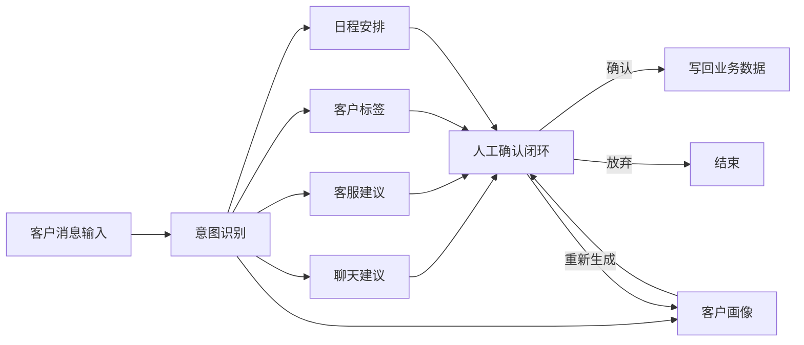
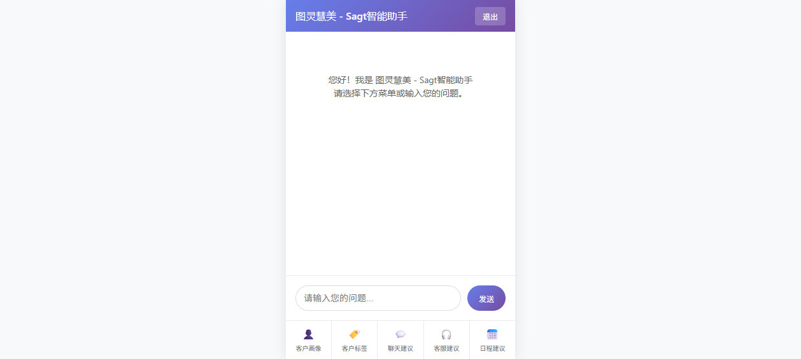
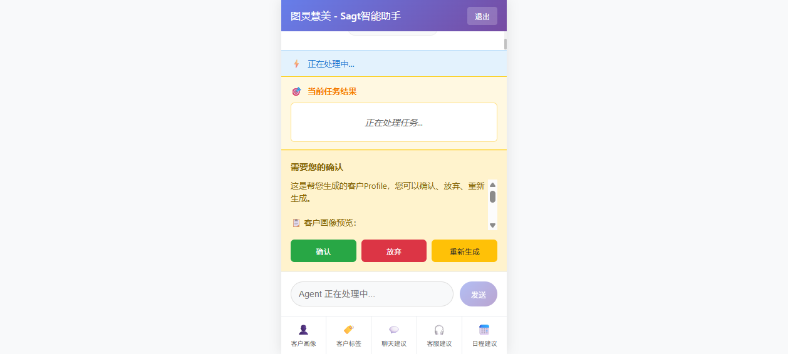
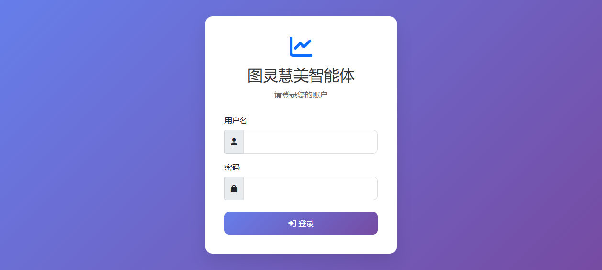
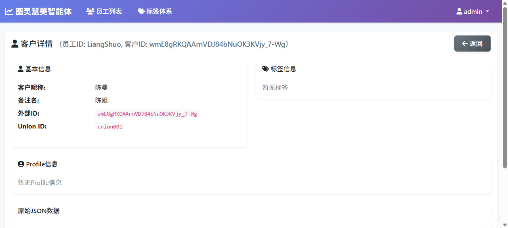
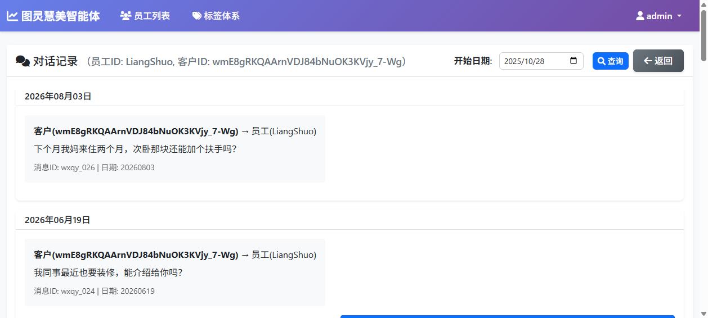
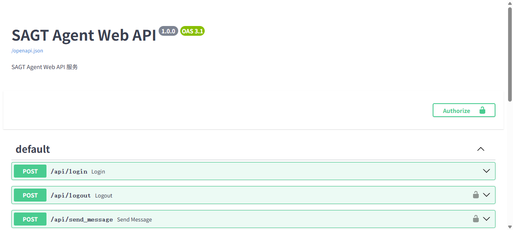

# Sagt 零售销售智能体系统

基于 **LangGraph** 构建的面向零售门店销售的智能助手：根据客户聊天记录、客服记录与订单数据，自动生成**客户画像、客户标签、聊天话术、客服回复与跟进日程**，关键动作在写入前通过企业微信推送给销售本人确认，实现「AI 自主 + 人工管控」的平衡。

## 系统架构

系统由四个服务组成：

| 模块 | 说明 | 端口 |
|---|---|---|
| `sagt_agent` | 智能分析引擎，LangGraph 图编排 + 工具调用 | 2024 |
| `sagt_client` | API 客户端，封装智能体调用与演示数据初始化 | - |
| `sagt_admin` | 管理后台，员工 / 客户 / 标签 / 会话 / 订单管理 | 5000 |
| `sagt_sidebar` | 销售侧边栏，业务菜单 + 自然语言双模式交互 | 8000 |



主图执行前会并行装配六类上下文：员工信息、标签体系、客户信息、企微聊天记录、客服记录、订单历史，保证每次生成都有完整的客户背景。

## 核心特性

### 1. 多子图智能体编排

主图完成意图识别后路由到五个业务子图（聊天建议 / 客服建议 / 客户标签 / 客户画像 / 日程安排），每个子图维护独立的 State 与节点集，利用 **Checkpoint** 支持任务中断恢复与执行轨迹追溯。

### 2. 人工确认闭环（Human-in-the-Loop）

在客户画像写入等关键节点，通过 `interrupt()` 暂停图执行，将生成结果推送到企业微信与侧边栏，由销售选择 **确认 / 放弃 / 重新生成**，再以 `Command` 路由到对应节点。AI 的建议永远不会未经确认就落库。





### 3. 企业微信深度集成

基于企业微信自建应用 API 实现：

- **消息通知**：任务结果与待确认事项实时推送给销售本人
- **日程创建**：识别对话中的时间约定（如「明天上午10点上门」）自动创建企微日程
- **客户标签**：结合聊天内容与订单历史生成标签建议，确认后调用企微接口更新

配置步骤（CorpID / AgentId / Secret / 回调 / 可信 IP）见 [WECOM_SETUP.md](WECOM_SETUP.md)。

### 4. 管理后台

员工管理、客户列表、客户详情（画像 / 标签）、对话记录、客服记录、订单查询五大模块，支撑运营监督与数据管理。









## 技术栈

- **智能体编排**：LangGraph（多子图 / Checkpoint / interrupt + Command）、LangGraph Store
- **模型**：通义千问 qwen3.8-flash（OpenAI 兼容接口）
- **后端**：FastAPI（侧边栏）、Flask（管理后台）、uv 包管理
- **集成**：企业微信自建应用 API、微信客服
- **部署**：Linux + LangGraph dev / Docker Compose（生产可用 PostgreSQL + Redis 持久化）

## 快速开始

```bash
# 1. 启动智能体引擎（LangGraph dev，端口 2024）
cd sagt_agent
uv sync
cp .env.example .env        # 填入模型与企业微信配置
bash run_sagt_agent_dev.sh

# 2. 初始化演示数据（员工 / 客户 / 聊天 / 订单 / 标签）
cd ../sagt_client
uv run python store_client/sagt_demo_init.py

# 3. 启动管理后台（端口 5000，默认账号 admin / admin123）
cd ../sagt_admin
uv sync
cp .env.example .env
uv run sagt_admin_app.py

# 4. 启动销售侧边栏（端口 8000）
cd ../sagt_sidebar
uv sync
cp .env.example .env
uv run sagt_sidebar_app.py
# 浏览器访问 http://localhost:8000/sagt_web/login.html
```

> 演示数据存放在 LangGraph Store 中，`langgraph dev` 为内存模式，**服务重启后需重新执行第 2 步**。

## 环境变量

| 变量 | 说明 |
|---|---|
| `MODEL_PROVIDER` / `MODEL_NAME` / `API_KEY` / `BASE_URL` | 大模型接入配置（OpenAI 兼容） |
| `USER_TOKEN` / `USER_ID` / `USER_PASSWORD` | 智能体登录账号与访问令牌 |
| `USER_EXTERNAL_ID` | 关联的客户（外部联系人）标识 |
| `WXWORK_CORP_ID` / `WXWORK_APP_ID` / `WXWORK_APP_SECRET` | 企业微信自建应用凭据 |
| `ADMIN_USER_ID` / `ADMIN_PASSWORD` | 管理后台登录账号 |
| `DATABASE_URI` / `REDIS_URI` | 生产部署时的持久化配置（可选） |

## 目录结构

```
sagt-202610/
├── sagt_agent/          # 智能分析引擎（LangGraph 图、工具、鉴权）
│   └── src/
│       ├── auth/        # LangGraph 自定义鉴权（token → 身份注入）
│       ├── graphs/      # 主图 + 五个业务子图
│       ├── llm/         # 各任务的提示词与模型调用
│       ├── tools/       # 企业微信工具、业务数据工具
│       ├── models/      # 数据结构定义
│       └── webapp/      # 登录与健康检查接口
├── sagt_client/         # API 客户端与演示数据初始化
├── sagt_admin/          # 管理后台（Flask）
├── sagt_sidebar/        # 销售侧边栏（FastAPI + 静态前端）
├── docs/screenshots/    # 系统截图
├── WECOM_SETUP.md       # 企业微信配置指南
└── sagt_client/DEMO_SCENARIO.md  # 演示业务场景说明
```
